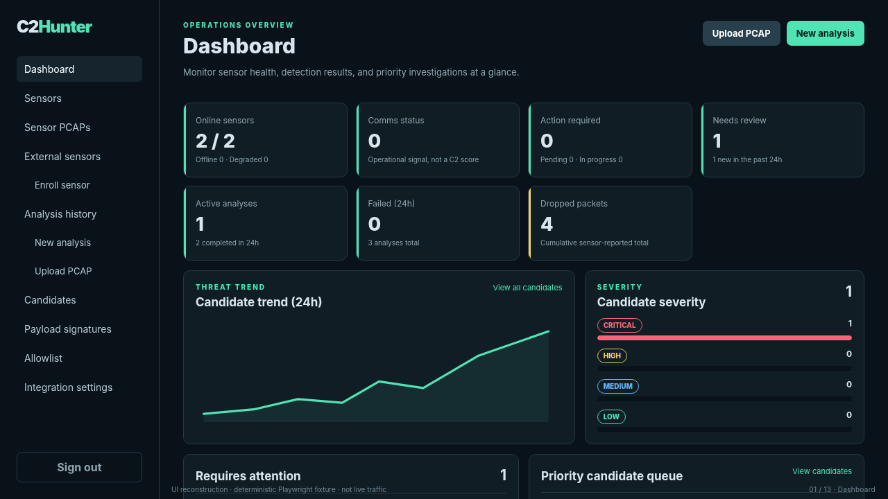
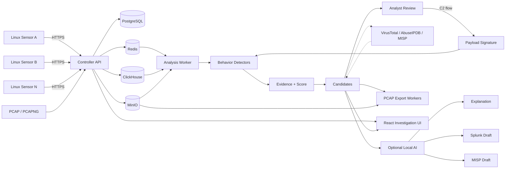
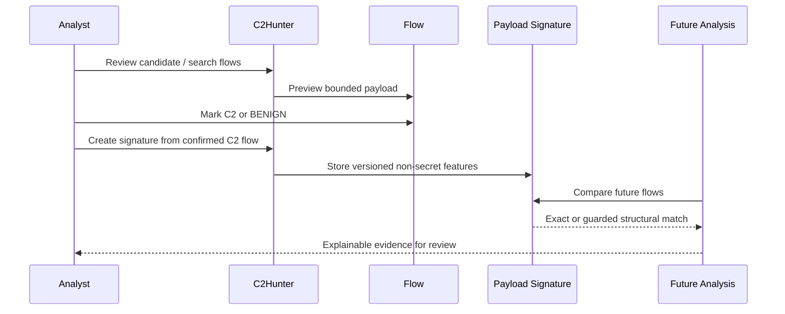

# C2Hunter

### Hunt unknown C2 infrastructure from behavior — not just known IOCs.

**C2Hunter is a network threat hunting platform that correlates live sensor traffic and offline PCAPs to detect, rank, and explain likely command-and-control infrastructure.**

[](https://github.com/piecer/c2hunter/actions/workflows/ci.yml)
[](https://github.com/piecer/c2hunter/stargazers)
[](https://github.com/piecer/c2hunter/commits/master)


[](docs/assets/c2hunter-demo.gif)

**Live traffic · PCAP/PCAPNG · Multi-sensor correlation · Explainable scoring · Threat-intel enrichment · Analyst-guided payload signatures · Network / DDoS analysis · Optional evidence-grounded AI**

[Quick Start](#quick-start) · [How It Works](#how-it-works) · [Analysis Modules](#analysis-modules) · [Detection Signals](#detection-signals) · [Optional AI](#optional-local-ai-analysis) · [Architecture](#architecture) · [Configuration](#configuration) · [Documentation](#documentation)

---

## Why C2Hunter?

Traditional network detection is strongest when you already know what to look for: an IOC, signature, domain, IP, or protocol pattern.

C2Hunter is built for the harder question:

> **What if the C2 infrastructure is not known yet?**

Instead of treating each connection in isolation, C2Hunter looks for **behavior shared across hosts, time, payload characteristics, and independent sensors**.

```text
                        Traditional IOC detection

        Known IP / Domain / Signature
                    │
                    ▼
                 Match rule
                    │
                    ▼
                   Alert


                         C2Hunter

               Unknown destinations
                    │
                    ▼
              Network behavior
                    │
          ┌─────────┼─────────┐
          ▼         ▼         ▼
      Host       Time      Payload
   correlation  patterns   features
          │         │         │
          └─────────┼─────────┘
                    ▼
             Evidence scoring
                    │
                    ▼
              C2 candidates
                    │
                    ▼
        Threat-intel context (optional)
                    │
                    ▼
              Analyst review
```

C2Hunter is designed for **defensive analysis**. It does not connect to candidate C2 servers, scan the Internet, decrypt TLS, replay malware commands, or reproduce attacks.

---

## What You Get

| Capability | What it does |
|---|---|
| **Multi-host correlation** | Finds external destinations shared by multiple internal hosts instead of judging a single flow alone. |
| **Periodic beacon detection** | Detects stable recurring communication patterns commonly associated with beaconing. |
| **Synchronized communication** | Identifies groups of hosts contacting the same destination at similar times. |
| **Multi-sensor context** | Correlates independent observations collected by distributed Linux sensors. |
| **Offline PCAP analysis** | Parses PCAP and PCAPNG into normalized records; C2 analysis shares the detector, allowlist, and scoring pipeline with sensor jobs. |
| **Three analysis modules** | Select `c2`, `network_anomaly`, or `ddos_attack` for uploaded captures or sensor-based jobs. |
| **Network troubleshooting** | Groups observed TCP retries/resets, duplicate ACKs, UDP duplicate candidates, and ICMP errors, with bounded supporting measurements and coverage warnings. |
| **DDoS attack traffic analysis** | Separately classifies bounded TCP/UDP/ICMP flood shapes, defensive resource-exhaustion objectives, and human-reviewed response options without feeding C2 automation. |
| **TCP communication-status candidates** | Surfaces repeated SYN retransmissions as an operational `COMMUNICATION_STATUS` candidate, kept separate from C2 scoring. |
| **Explainable evidence** | Shows which detectors contributed to a candidate score and why, including score adjustments. |
| **Threat-intel enrichment and opt-in automation** | Adds VirusTotal, AbuseIPDB, and MISP context without changing detector scores. Separate ADMIN-enabled policies can register MISP attributes and record automated verdicts. |
| **Candidate triage** | Filters and ranks the candidate queue and applies review / confirmed-C2 / false-positive verdicts to explicitly selected candidates in bulk. |
| **Detection tuning** | Detector weight presets, per-flow detection guidance, and expiring allowlist entries help reduce false positives. |
| **Human-guided detection** | Lets an analyst confirm a C2 flow and create a versioned payload signature for future analyses. |
| **Filtered PCAP evidence export** | Exports bounded candidate or filter-based traffic as valid PCAP/PCAPNG evidence, synchronously for small sources and through a durable async job for large ones. |
| **Operations dashboard** | Fleet health, active/completed analyses, candidate severity and workflow counts, and 24-hour trends in one view. |
| **Local AI analysis** | Explains C2, network, or DDoS evidence; C2 runs can draft Splunk queries and MISP data for review. |
| **Stored-evidence AI investigations** | Investigates an observed IP with cited, read-only evidence tools; experimental JOB mode selects a bounded set of peers rather than claiming whole-capture coverage. |
| **REST API** | Integrates with SIEM, SOAR, scripts, and other defensive workflows. |

See [DDoS attack traffic analysis](docs/ddos-attack-analysis.md) for classification, uncertainty, response, resource bounds, and benchmark contracts.

---

## How It Works



The analysis pipeline is deliberately evidence-first:

```text
Packets
  ↓
Normalized flows
  ↓
Behavior / statistical detectors
  ↓
Evidence contributions
  ↓
Adjustments / allowlists / detector weights
  ↓
Candidate score
  ↓
Threat-intel context (supporting, optional)
  ↓
Analyst review
```

A score is a **review-priority signal**, not an attribution verdict.

---

## Analysis Modules

PCAP upload requests select a module with `analysis_module`; live/historical job requests use `analysis.module`:

| Module | Purpose | Produces |
|---|---|---|
| `c2` *(default)* | C2 hunting from behavior across hosts, time, payload, and sensors | Scored C2 candidates with evidence |
| `network_anomaly` | Capture-local network troubleshooting, independent of C2 scoring | `network-pattern-report-v1`, grouped issues, representative evidence, and qualified RTT / spacing / TTL observations when available |
| `ddos_attack` | DDoS attack traffic classification and response guidance | `ddos-attack-report-v4`; new offline uploads also receive separate `pcap-attack-guidance-v1` review guidance |

Network and DDoS jobs produce domain reports, **not C2 candidates**. Optional AI interpretation uses the matching `NETWORK_ANOMALY` or `DDOS_ATTACK` run kind, not C2 ranking, Splunk/MISP drafts, or C2 automation.

- **Network observations are not root-cause proof.** Capture-local RTT is not end-host latency; retries, missing replies, and TTL variation do not by themselves establish packet loss, congestion, or route changes. Missing measurements remain unknown, and LIVE aggregate records do not acquire packet-level evidence by inference. See [Network Measurement Quality](docs/network-measurement-quality.md).
- **DDoS review is bounded and passive.** Thresholds are tunable; an analyst can select a separate normal-reference dataset for signature-candidate evaluation. Structured JSON exports and narrowly supported offline BPF filters are review artifacts, not automatic blocking rules.
- **Offline attack guidance is a separate review aid.** It highlights suspicious time windows even when strict DDoS conditions are not met; a review candidate is not a confirmed attack, and `NO_CANDIDATE` does not establish benign traffic. See [DDoS Attack Analysis](docs/ddos-attack-analysis.md).

---

## Detection Signals

C2Hunter can combine multiple independent signals instead of relying on one indicator.

| Signal | What C2Hunter looks for |
|---|---|
| **Common destination** | Multiple internal hosts contacting the same external destination |
| **Non-well-known port** | Repeated external communication over unusual service ports |
| **Periodic beacon** | Stable recurring intervals across repeated communication |
| **Single-host composite beacon** | Persistent low-volume beacon behavior from one host |
| **Synchronized communication** | Multiple hosts communicating within similar time windows |
| **Command → attack correlation** | Suspicious activity following likely command communication |
| **Persistence / rarity** | Long-lived communication with otherwise uncommon destinations |
| **Protocol / payload similarity** | Shared protocol and payload characteristics across hosts |
| **Multi-sensor context** | Independent observation from more than one sensor |
| **Analyst payload signature** | Exact or guarded structural match against analyst-confirmed payload features |
| **Population anomaly** | Candidate behavior that is unusual relative to other traffic in the same analysis (optional ML anomaly) |
| **TCP session quality** | Session-establishment evidence used to reduce low-quality TCP signals |
| **TCP SYN retry pattern** | Periodic outbound SYN retransmissions with the same initial sequence, reported as `TCP_COMMUNICATION_ATTEMPT_PATTERN` on a separate `COMMUNICATION_STATUS` candidate |

`COMMUNICATION_STATUS` candidates are operational status, not C2 maliciousness. They are counted separately on the dashboard and excluded from automatic threat-intel enrichment and MISP registration. `NO_COMPLETION_OBSERVED` records an absence of response; it does not prove that a host or service is unreachable.

### Severity

| Score | Severity |
|---:|---|
| `80–100` | **CRITICAL** |
| `60–79` | **HIGH** |
| `40–59` | **MEDIUM** |
| `0–39` | **LOW** |

Review the evidence, affected internal hosts, independent sensor observations, timing, warnings, and packet context before escalation.

### Tuning

- **Detector weights** can be set per analysis and saved as reusable **presets**.
- **Detection guidance** explains, for a flow an analyst marked as C2, which conditions held, the score gap versus the candidate threshold, and a suggested reanalysis payload.
- **Allowlists** support `IP`, `CIDR`, `DOMAIN_SUFFIX`, `TLS_FINGERPRINT`, `CERT_FINGERPRINT`, `TRUSTED_DNS`, and `TRUSTED_NTP` entries, optionally with an expiry time.

---

## Threat-Intel Enrichment

When an analysis stores C2 candidates, the Controller schedules lookups under the saved integration policy. Provider credentials are supplied by the deployment:

| Provider | Configuration |
|---|---|
| VirusTotal | `C2HUNTER_VIRUSTOTAL_API_KEY` |
| AbuseIPDB | `C2HUNTER_ABUSEIPDB_API_KEY` |
| MISP | `C2HUNTER_MISP_URL`, `C2HUNTER_MISP_API_KEY` |

- Non-secret policies are imported once from Controller settings, then persisted. An `ADMIN` manages provider enablement, MISP events, and automation in **Settings → Threat intelligence & MISP**; `GET/PUT /api/v1/integration-settings` also exposes lookup limits and worker/queue settings. Later environment changes do not overwrite the saved policy. API keys stay in deployment secrets, not the UI or settings API.
- Ordinary auto-enrichment defaults to the top **20 candidates per job**. `candidate_auto_enrichment_enabled=false` or a zero limit disables that ordinary path. When immediate-action automation is enabled, it schedules all eligible C2 candidates instead of applying the top-N limit.
- Lookups use a bounded executor. External TI/MISP HTTP requests are serialized within each Controller process with a configurable delay (default **1 second**) between requests. Lookup failures or queue overflow are recorded separately from deterministic analysis results.
- Candidate lists expose a compact `ti_assessment` and support `ti_filter=POSITIVE|MISP_MATCH|INCOMPLETE` and `sort=-ti_priority`. The priority ordering is explainable and does **not** change the detector score.
- An analyst can re-run lookups manually from a candidate. Bulk verdicts support up to **200 explicitly selected IDs** and return per-candidate results.

`NO_SIGNAL` means the lookup finished and found no known external signal — it is **not** a benign verdict. `PENDING`, `PARTIAL`, `FAILED`, and `INCOMPLETE` indicate missing information, not low risk.

### Optional MISP automation

Both policies are **off by default** and require an ADMIN to enable them:

- **Management registration** adds candidate IP attributes to a configured existing MISP event.
- **Immediate-action registration** requires the configured number of positive providers (default **2**, configurable from **2 to 3**). After successful registration in a separate MISP event, it records an `origin=AUTOMATION` / `CONFIRMED_C2` decision and a `PENDING` follow-up action. Matches from the configured management and immediate-action events are excluded from this policy's MISP-positive count.

This is an explicit exception to manual-only verdicts and MISP writes, **not an AI decision**. MISP registration does not prove that downstream blocking occurred; C2Hunter does not automatically mark the follow-up action completed or issue firewall commands.

---

## Human-Guided Payload Detection

C2Hunter can turn analyst knowledge into reusable detection evidence.



Payload matching can use features such as:

- payload SHA-256
- prefix hash
- payload length
- entropy
- printable ratio
- SimHash

Signatures have tunable length tolerance, entropy tolerance, and SimHash distance, and can be enabled, disabled, or deleted.

**Exact matches are high-confidence evidence. Structural similarity remains review-oriented.**

Completed analysis results stay immutable; reanalysis applies the current signature set to an existing dataset.

---

## Optional Local AI Analysis

AI is **off by default** and does not replace deterministic analysis. Model explanations, stored facts, and analyst decisions remain separate; a model failure does not change the original detector score or completed analysis result.

### Choose the AI workflow

| Workflow | Scope and output | Availability |
|---|---|---|
| **C2 AI run** | Reviews up to five selected candidates; explains supporting/counter evidence and drafts Splunk hunting/detection SPL and MISP data. Optional `discovery_mode=shadow` adds bounded within-job behavioral discovery without changing detector scores. | Existing `ai-runs` API and optional Compose `ai-worker` |
| **Network / DDoS interpretation** | Explains the matching deterministic domain report, preserving uncertainty and evidence references; no C2 candidate or Splunk/MISP draft generation. | Existing `ai-runs` API with `analysis_kind=NETWORK_ANOMALY` or `DDOS_ATTACK` and a supported, available model |
| **IP investigation** | Investigates one observed IPv4/IPv6 address, including an internal host or noncandidate endpoint, with retained evidence citations and tool history. | Separate `ai-investigations` API; supported model plus an investigation supervisor required |
| **Experimental JOB investigation** | Selects **1–3 peers** from a bounded observed-peer pool and investigates only that selection. Unselected peers remain unassessed. | Separate `ai-job-investigations` API; additional opt-in gate and an owned local dispatcher; **not supported by the default Redis-backed Compose topology** |

C2 AI artifacts are review drafts: approval does not itself deploy a Splunk rule or send data to MISP. Neither AI workflow issues firewall commands or triggers the separate TI/MISP automation policy.

### Enable existing AI runs in Compose

Configure an **already installed** model. For example, edit `.env` for a host-side Ollama service:

```dotenv
# Enable AI admission and replace the model placeholder with an installed model tag.
C2HUNTER_AI_ANALYSIS_ENABLED=true
C2HUNTER_AI_MODEL_PROVIDER=ollama
C2HUNTER_AI_MODEL_BASE_URL=http://host.docker.internal:11434
C2HUNTER_AI_MODEL_NAME=your-installed-model
```

Then start the optional worker:

```bash
# Start the stack with the separate AI worker and check its container status.
COMPOSE_PROFILES=ai make up
docker compose --env-file .env --profile ai ps ai-worker
```

Supported providers are `ollama`, `openai-compatible`, and `fake`. The default `fake` provider is a deterministic test implementation, **not real inference**; it does not enable the stored-evidence investigation transport. An OpenAI-compatible model server uses its `/v1` base URL and, when required, `C2HUNTER_AI_MODEL_API_KEY`. Network/DDoS interpretation availability is exposed by `GET /api/v1/ai-capabilities`.

Do not assume a model endpoint is private merely because this feature is called local AI. Existing AI runs require request consent for an endpoint classified as remote. Review the destination and data policy before enabling it.

### Stored-evidence investigations: explicit runtime boundaries

- **IP investigations** use five server-controlled, read-only tools: peer overview, timeline, flow samples, protocol observations, and cohort comparison. They do not run shell/SQL commands, contact target IPs, query external TI, or disclose raw payloads. Preview the source scope before starting from analysis details or a candidate/flow endpoint.
- The existing `ai-worker` integrates IP supervision. A single-process deployment can instead opt into `C2HUNTER_AI_INVESTIGATION_INLINE_ENABLED=true`. Both paths also require `C2HUNTER_AI_ANALYSIS_ENABLED=true` and a supported provider.
- Investigation transport accepts literal IP endpoints and pinned localhost names, **not `host.docker.internal` or arbitrary DNS aliases**. The Compose example above is for existing AI runs; investigations need a permitted literal address reachable from the worker. Container loopback is not the host's loopback.
- **JOB investigations** additionally require `C2HUNTER_AI_JOB_INVESTIGATION_ENABLED=true`, the memory queue, and an actually owned accepting inline supervisor. Memory/SQLite and explicitly migrated PostgreSQL repositories are supported with that runtime. Setting flags or starting the distributed AI worker alone does not provide JOB dispatch.
- These investigation flags are application settings but are **not forwarded by the supplied Compose file**. Adding them to `.env` alone is insufficient; a compatible custom runtime must pass them explicitly. This is not a recommendation to convert the running Compose stack to an in-memory queue.
- Check `GET /api/v1/ai-investigations/capabilities` or `GET /api/v1/ai-job-investigations/capabilities` with an authenticated `ANALYST` or `ADMIN` token. Configured capability is not proof of model readiness. Runs, history, and cited evidence are owner-scoped; administrative role does not bypass that ownership boundary.
- A completed investigation means its bounded result was stored, **not** that the whole capture was inspected or omitted peers are benign. Cancellation acknowledgment does not prove an in-flight model request has stopped or worker capacity has been released.

See [IP Investigations](docs/ai-investigations.md), [Experimental JOB Investigations](docs/ai-job-investigations.md), and [Local AI System](AI_C2_ANALYSIS_SYSTEM.md). [Generated-data Investigation Evaluation](docs/ai-investigation-evaluation.md) is a separate opt-in comparison harness: its default offline output is `OFFLINE_NOT_EXECUTED`, not evidence of model accuracy or deployment acceptance.

---

## Quick Start

### Requirements

For the containerized stack:

- Linux or WSL2 with Docker Engine and Docker Compose (`docker compose`, including `up --wait`)
- Git and GNU Make

For local development, tests, or building a sensor tarball, also install:

- Python `3.12` (the Makefile defaults to `python3.12`)
- Go (minimum and CI version: `1.26.11`)
- Node.js (CI uses `22.14.0`) and npm `10+`
- A C compiler/toolchain for the sensor's CGO/static-link build

Host-side Python, Go, and Node.js are not required just to run `make up`; the Compose images build their own components.

Suggested development host:

- 4 CPU
- 8 GiB RAM
- 20 GiB free disk

Reference benchmark host:

- 8 vCPU
- 16 GiB RAM
- NVMe storage

### Start C2Hunter

```bash
# Clone the source and create local configuration without overwriting an existing .env.
git clone https://github.com/piecer/c2hunter.git
cd c2hunter
test -f .env || cp .env.example .env

# Before continuing, edit .env and replace every change-me value.
# Use this development configuration only on an isolated, trusted host.
make up
```

`make up` builds and starts the Compose stack and waits for health checks. The one-shot `postgres-migrate` service initializes/upgrades the schema before the Controller and workers start. It is expected to exit successfully rather than stay running. For an existing deployment, back up the database and review migrations before upgrading.

Verify the controller:

```bash
# Check liveness and backing-service readiness separately.
curl --fail http://localhost:8000/api/v1/health
curl --fail http://localhost:8000/api/v1/ready
```

Open **http://localhost:8080**. The supplied `.env.example` enables the **Development login** form; enter a username to obtain a temporary development ADMIN session. This is not a password-authenticated production login.

> The example enables `C2HUNTER_DEV_LOGIN_ENABLED=true`, although the application/Compose fallback is false. The supplied Compose port mappings are not restricted to loopback. Keep this setup off untrusted networks; disable development login and configure authentication and HTTPS ingress before any shared deployment.

For local development, install the pinned Python and web dependencies separately:

```bash
# Create .venv, install requirements.lock and editable packages, then run npm ci in web/.
make setup
```

Stop the stack without deleting its named data volumes:

```bash
# Stop/remove the Compose services; do not add --volumes unless deleting stored data is intended.
make down
```

---

## Analyze a PCAP

C2Hunter accepts classic PCAP and PCAPNG captures.

From the UI:

```text
Analysis history
    ↓
Upload PCAP
    ↓
Choose analysis module (c2 / network_anomaly / ddos_attack)
    ↓
Configure internal CIDRs
    ↓
Run analysis
    ↓
Review C2 candidates or the selected network / DDoS report
    ↓
Inspect evidence / flows / PCAP; review TI for C2 candidates
```

The default upload limits are:

- `500 MiB` (`C2HUNTER_PCAP_UPLOAD_MAX_BYTES`)
- `2,000,000` timestamped packets (`C2HUNTER_PCAP_UPLOAD_MAX_PACKETS`)

Supported link types include Ethernet, raw IP, Linux cooked v1/v2, and loopback.

### Two-step upload API (recommended)

The job is created first and the capture is uploaded separately, so the job ID — and therefore upload, parsing, queueing, and execution state — is available from the first response.

```text
POST /api/v1/pcap-analysis-jobs/initiate          # create the job (JSON metadata)
PUT  /api/v1/pcap-analysis-jobs/{job_id}/capture  # upload the raw PCAP/PCAPNG
GET  /api/v1/analysis-jobs/{job_id}               # poll status
```

After the original is stored, the upload returns `202 Accepted`. Track `status` together with the more detailed `processing.phase`; the public processing phases progress through:

```text
UPLOAD_STORED → PARSING → ANALYSIS_QUEUED → ANALYSIS_RUNNING → COMPLETED | FAILED | CANCELLED
```

The legacy single-request binary upload `POST /api/v1/pcap-analysis-jobs` is still supported for compatibility.

See the [External API Reference](docs/external-api-reference.md) for request parameters and examples.

---

## Export Evidence as PCAP

Candidates or analyst-defined flow filters can be exported as bounded PCAP/PCAPNG evidence from uploaded, completed live, and reanalysis sources.

```text
POST /api/v1/pcap-exports                  # create or reuse an export
GET  /api/v1/pcap-exports/{id}             # status and progress
POST /api/v1/pcap-exports/{id}/cancel      # cancel
GET  /api/v1/pcap-exports/{id}/download    # download the completed artifact
```

- In the default `hybrid` mode, sources up to **32 MiB and 100,000 packets** are exported synchronously; larger or unknown-size sources become durable async jobs handled by the `pcap-export-worker`.
- Filters support scalar conditions plus up to 20 `include_filters` and 20 `exclude_filters` groups (fields inside a group are AND-ed, groups are OR-ed).
- `Idempotency-Key` is supported, and full queues return `429 PCAP_EXPORT_QUEUE_FULL` with `Retry-After`.
- Completed artifacts are size- and SHA-verified before they are marked `COMPLETED`.
- Indexed export (`C2HUNTER_PCAP_INDEXED_EXPORT_MODE`) and the PCAP posting index are **off by default**; the offset index for live captures is on by default.

Benchmark with `make benchmark-pcap-export`.

---

## Deploy External Sensors

Sensors run as independent Linux agents outside the central Docker Compose stack.

Build the sensor:

```bash
make sensor-agent
```

Install it on the sensor host:

```bash
tar -xzf artifacts/c2hunter-sensor-dev-linux-amd64.tar.gz
cd c2hunter-sensor

sudo ./install-sensor.sh \
  --controller-url https://c2hunter.example.com \
  --enrollment-token '<ONE_TIME_TOKEN>'

sudo systemctl start c2hunter-sensor
sudo systemctl status c2hunter-sensor
```

Enrollment is a one-time-token flow: an `ADMIN` creates a token (`POST /api/v1/sensor-enrollments`), the agent claims it for a long-lived credential, registers, and then polls its configuration. Agents authenticate with the `X-Sensor-Token` header; credentials can be rotated or revoked from the Controller.

Each capture interface can be configured as:

- `INBOUND`
- `OUTBOUND`
- `BIDIRECTIONAL`
- `UNKNOWN`

Each interface also supports its own BPF filter and optional PCAP retention.

The agent uses an independent AF_PACKET → Flow → spool → upload pipeline for each enabled interface, so an error on one interface does not need to stop all capture sources.

The installer creates a dedicated non-root user and limits packet-capture privileges to the required Linux capabilities.

---

## Analysis Lifecycle

Sensor-based jobs move through a visible state machine:

```text
CREATED
   ↓
WAITING_FOR_SENSOR
   ↓
CAPTURING
   ↓
UPLOADING
   ↓
INGESTING
   ↓
ANALYZING
   ↓
COMPLETED / PARTIALLY_COMPLETED / FAILED / CANCELLED
```

Uploaded PCAP jobs expose the phases described in [Analyze a PCAP](#analyze-a-pcap).

Reanalysis creates a new run against the original immutable dataset rather than silently rewriting completed results.

---

## Architecture

C2Hunter separates capture, control, flow storage, object storage, queueing, and analysis.

```text
External Linux Sensors
        │
        │ outbound authenticated HTTPS
        ▼
┌──────────────────────────┐
│      Controller API      │◄──────── Browser / REST clients
└────────────┬─────────────┘
             │
     ┌───────┼───────────┬───────────┐
     ▼       ▼           ▼           ▼
PostgreSQL ClickHouse    MinIO      Redis
 metadata    flows     PCAP/artifacts queue
                                      │
                                      ▼
                               Analysis Worker
                                      │
                                      ▼
                         Detectors + Evidence (+ AI)
```

The default Compose topology contains:

| Service | Role |
|---|---|
| `controller` | REST API, orchestration, threat-intel enrichment |
| `worker` | Analysis worker (detectors, scoring) |
| `pcap-export-worker` | Durable async PCAP export jobs |
| `pcap-offset-index-worker` | PCAP offset / posting index builds and reconciliation |
| `web` | React investigation UI (reverse proxy to the Controller) |
| `postgres` | Metadata |
| `redis` | Queue |
| `clickhouse` | Flow storage |
| `minio` | PCAP and artifact object storage |
| `ai-worker` *(profile `ai`)* | Optional local AI analysis worker |

It is a single-host development topology, not a production HA deployment.

---

## Configuration

Copy `.env.example` to `.env` and replace every `change-me` value. Commonly used settings:

| Area | Variables |
|---|---|
| Environment | `C2HUNTER_ENVIRONMENT`, `CONTROLLER_PORT` (default `8000`), `WEB_PORT` (default `8080`) |
| Datastores | `POSTGRES_*`, `CLICKHOUSE_*`, `MINIO_ROOT_USER`, `MINIO_ROOT_PASSWORD`, `C2HUNTER_S3_BUCKET` |
| Auth | `C2HUNTER_API_AUTH_REQUIRED`, `C2HUNTER_{VIEWER,ANALYST,ADMIN}_TOKEN_SHA256`, `C2HUNTER_DEV_LOGIN_ENABLED` |
| Rate limits | `C2HUNTER_RATE_LIMIT_WINDOW_SECONDS`, `C2HUNTER_ANALYSIS_JOB_RATE_LIMIT`, `C2HUNTER_ENROLLMENT_CLAIM_RATE_LIMIT`, `C2HUNTER_TRUSTED_PROXY_CIDRS` |
| PCAP upload / export | `C2HUNTER_PCAP_UPLOAD_MAX_*`, `C2HUNTER_PCAP_EXPORT_*`, `C2HUNTER_PCAP_OFFSET_INDEX_*`, `C2HUNTER_PCAP_POSTING_INDEX_*` |
| Threat intel | `C2HUNTER_VIRUSTOTAL_API_KEY`, `C2HUNTER_ABUSEIPDB_API_KEY`, `C2HUNTER_MISP_*`, `C2HUNTER_CANDIDATE_AUTO_ENRICHMENT_LIMIT` |
| Local AI | `C2HUNTER_AI_ANALYSIS_ENABLED`, `C2HUNTER_AI_MODEL_*` |

See [Deployment](docs/deployment.md) for the full reference.

---

## Security Boundaries

C2Hunter is designed as a defensive analysis platform.

It intentionally does **not**:

- connect to suspected C2 servers,
- actively scan Internet hosts,
- replay botnet or malware commands,
- decrypt TLS,
- automatically block traffic based on AI output,
- automatically publish MISP events based only on AI output or threat-intel results,
- automatically confirm a candidate from threat-intel results.

For non-development deployments, keep the Controller private behind HTTPS ingress and configure role-based API token digests.

Roles:

| Role | Capability |
|---|---|
| `VIEWER` | Read |
| `ANALYST` | Investigations and finding management |
| `ADMIN` | Analyst capabilities plus sensor / detector management |

Generate a token and its digest:

```bash
TOKEN="$(openssl rand -base64 32)"
printf '%s' "$TOKEN" | sha256sum   # put this digest in .env
```

Static role tokens are a minimum deployment control, not a substitute for production identity, OIDC, MFA, or centralized session management.

---

## REST API

The API prefix is:

```text
/api/v1
```

Swagger UI:

```text
http://localhost:8000/docs
```

ReDoc:

```text
http://localhost:8000/redoc
```

OpenAPI document:

```text
http://localhost:8000/openapi.json
```

Main resource groups:

| Group | Examples |
|---|---|
| Health | `/health`, `/ready`, `/metrics` (Prometheus) |
| Dashboard | `/dashboard` |
| Sensors | `/sensors`, `/sensor-groups`, `/sensor-enrollments`, sensor agent endpoints |
| Analysis jobs | `/analysis-jobs`, `/pcap-analysis-jobs/initiate`, reanalysis, cancel |
| Flows | `/analysis-jobs/{id}/flows`, payload preview, flow labels, detection guidance |
| Candidates | `/candidates`, verdicts, threat-intelligence lookups, MISP exports |
| Tuning | `/allowlist`, `/payload-signatures`, `/detector-weight-presets` |
| Evidence | `/pcap-exports`, `/sensor-pcaps` |

C2Hunter can be integrated with SIEM, SOAR, scripts, and defensive research pipelines. See the [External API Reference](docs/external-api-reference.md).

---

## Testing and Quality

```bash
# lint & static analysis
make lint               # ELF check, gofmt/vet, ruff, mypy, web lint, security lint
make lint-security      # ruff security rules + gosec

# tests
make test               # unit + integration
make test-unit
make test-integration
make test-coverage      # per-package coverage ratchets
make test-e2e           # Playwright browser tests

# AI
make test-ai
make evaluate-ai
make benchmark-ai

# data & benchmarks
make generate-test-pcaps
make benchmark-1m
make benchmark-ddos-analysis
make benchmark-pcap-export
make backtest-high-volume

# build & clean
make build
make clean
```

Coverage is enforced per package so aggregate numbers cannot hide a regression: Controller ≥ 80%, Analysis ≥ 86%, detectors ≥ 90%, Sensor ≥ 69%, and Sensor core packages ≥ 80%.

The repository includes deterministic browser fixtures and generated PCAP scenarios for repeatable testing.

---

## Repository Layout

| Path | Contents |
|---|---|
| `controller/` | Python Controller API, workers, and AI/threat-intel integrations |
| `analysis/` | Python detectors, scoring, and DDoS / high-volume analysis |
| `sensor/` | Go sensor agent and its worker |
| `web/` | React investigation UI |
| `proto/` | Protocol definitions |
| `deploy/sensor/` | Sensor installation assets |
| `scripts/` | Build scripts and Dockerfiles |
| `tools/` | Traffic generator, benchmarks, and repository checks |
| `testdata/` | Test fixtures and generated PCAPs |
| `docs/` | Detailed documentation |

---

## Documentation

| Document | Purpose |
|---|---|
| [Architecture](docs/architecture.md) | Components, trust boundaries, and data flow |
| [Data Model](docs/data-model.md) | Core entities and stored data |
| [Detection Logic](docs/detection-logic.md) | Detector behavior and scoring |
| [Detection Adjustment Guidance](docs/detection-adjustment-guidance.md) | Tuning and detection guidance |
| [Custom Detectors](docs/custom-detectors.md) | Extending detection logic |
| [Human-Guided Detection](docs/human-guided-detection.md) | Analyst labels and payload signatures |
| [DDoS Attack Analysis](docs/ddos-attack-analysis.md) | DDoS classification, response, bounds, and benchmarks |
| [External API Reference](docs/external-api-reference.md) | REST integration, threat intel, PCAP export |
| [Deployment](docs/deployment.md) | Deployment configuration |
| [Operations](docs/operations.md) | Operations and troubleshooting |
| [Security](docs/security.md) | Security assumptions and boundaries |
| [Dashboard Overview](docs/dashboard-overview.md) | Dashboard interpretation |
| [Local AI System](AI_C2_ANALYSIS_SYSTEM.md) | Evidence-first local AI architecture |

---

## Known Limitations

- Production OIDC/MFA and per-user distributed session management are not implemented.
- The default Compose deployment is not HA.
- TLS payloads are not decrypted.
- Payload retention is disabled by default.
- Packet-loss characteristics depend on the host kernel, NIC, mirror quality, capture filters, and privileges.
- A C2Hunter score is evidence for prioritization, not proof of malicious attribution.
- Threat-intel results are supporting context; absence of a signal is not evidence that a destination is benign.
- DDoS analysis returns no high-confidence or "no clear attack" verdict when observation coverage is incomplete.

---

## Contributing

Issues, reproducible PCAP scenarios, detector ideas, documentation improvements, and pull requests are welcome.

Useful contributions include:

- additional C2 behavioral detectors,
- false-positive reduction,
- protocol parsers,
- PCAP fixtures,
- performance benchmarks,
- SIEM/SOAR integrations,
- analyst workflow improvements.

If you found a bug, please include the analysis mode, relevant configuration, and a minimal reproducible capture or synthetic fixture when possible.

Before opening a pull request, run `make lint` and `make test`.

---

## License

C2Hunter is licensed under the [Apache License 2.0](LICENSE).

---

## Support the Project

If C2Hunter is useful for your threat-hunting, malware-analysis, SOC, or network-security work:

**⭐ Star the repository** — it helps other defenders discover the project.

You can also help by opening an issue with:

- a detection idea,
- a false-positive case,
- a reproducible PCAP scenario,
- a deployment report,
- or an integration you would like to see.

---

### C2Hunter

**Behavior → Evidence → Candidate → Analyst**

Built for defensive network threat hunting.

